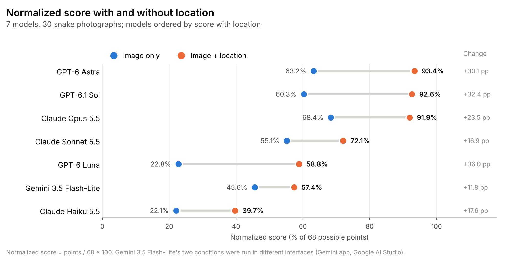
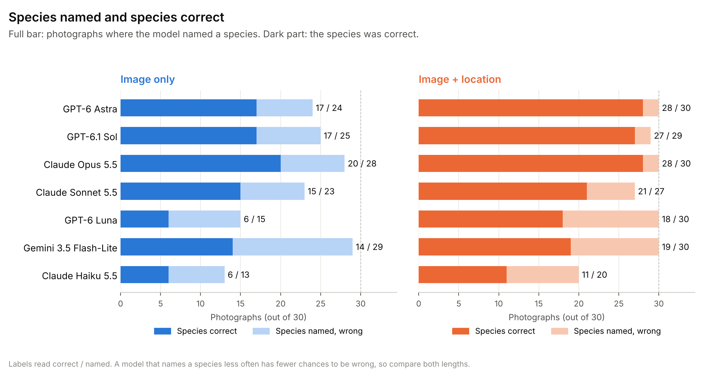
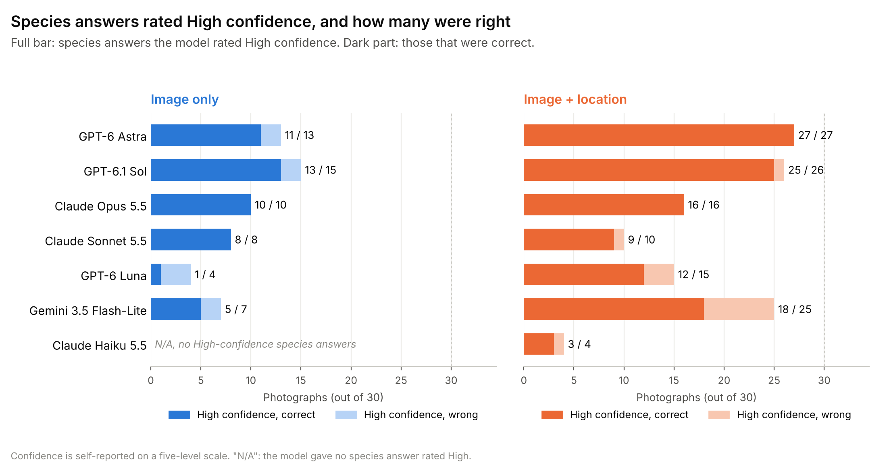
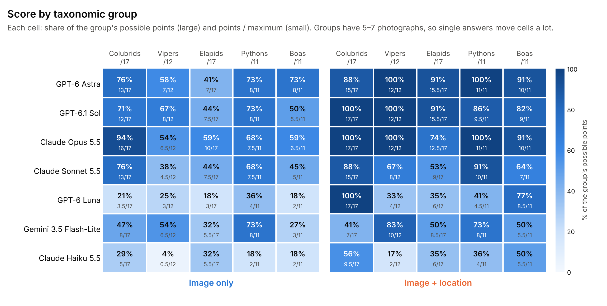

# Results — descriptive pilot analysis

**Primary scores and taxonomic accuracy are from the audited scoring decisions for v0.1.0.** Both conditions are scored row by row in `data/image_only_responses_scored_210.csv` and `data/location_responses_scored_210.csv`, generated by `code/score_zooid.py`. See `REPRODUCIBILITY.md` for audit limitations, and [EXPLORATORY_ANALYSES.md](EXPLORATORY_ANALYSES.md) for paired tests, item-level regressions, calibration and safety-relevant errors.

## Model-by-model paired outcomes

| Model | Score image only | Score + location | Normalized image only | Normalized + location | Score gain | Correct genera | Correct species | Correct subspecies |
|---|---:|---:|---:|---:|---:|---:|---:|---:|
| GPT-6 Astra | 43 | 63.5 | 63.2% | 93.4% | +30.1 pp | 24/30 → 29/30 | 17/30 → 28/30 | 3/8 → 7/8 |
| GPT-6.1 Sol | 41 | 63 | 60.3% | 92.6% | +32.4 pp | 23/30 → 30/30 | 17/30 → 27/30 | 3/8 → 7/8 |
| Claude Opus 5.5 | 46.5 | 62.5 | 68.4% | 91.9% | +23.5 pp | 25/30 → 29/30 | 20/30 → 28/30 | 4/8 → 6/8 |
| Claude Sonnet 5.5 | 37.5 | 49 | 55.1% | 72.1% | +16.9 pp | 21/30 → 25/30 | 15/30 → 21/30 | 3/8 → 4/8 |
| GPT-6 Luna | 15.5 | 40 | 22.8% | 58.8% | +36.0 pp | 10/30 → 20/30 | 6/30 → 18/30 | 0/8 → 3/8 |
| Gemini 3.5 Flash-Lite | 31 | 39 | 45.6% | 57.4% | +11.8 pp | 20/30 → 24/30 | 14/30 → 19/30 | 0/8 → 0/8 |
| Claude Haiku 5.5 | 15 | 27 | 22.1% | 39.7% | +17.6 pp | 10/30 → 17/30 | 6/30 → 11/30 | 0/8 → 2/8 |

The score maximum is 68; species/genus denominators are 30, and the exact subspecies denominator is eight. **Percentages are descriptive**, not an estimate of future test-set performance.

## Aggregate effect of location

- Mean species accuracy: **45.2% (95/210)** image-only → **72.4% (152/210)** with locality; **+27.1 percentage points**.
- Mean normalized score: **48.2%** image-only → **72.3%** with locality; **+24.1 percentage points**.
- Largest absolute species-accuracy gain: **GPT-6 Luna**, 6/30 → 18/30 (**+40.0 percentage points**).
- Smallest species-accuracy gains: **Gemini 3.5 Flash-Lite** and **Claude Haiku 5.5**, each **+16.7 percentage points**.
- Largest normalized-score gain: **GPT-6 Luna**; smallest normalized-score gain: **Gemini 3.5 Flash-Lite**.
- Every model's total score and correct species count increased with locality. A net gain does **not** imply that no individual specimens regressed: **11 individual answers lost points** with locality, all from the four lower-scoring models (see [EXPLORATORY_ANALYSES.md](EXPLORATORY_ANALYSES.md)).

## Species-coverage and high-confidence precision

| Model | High-confidence precision: image only | High-confidence precision: + location | Species attempts: image only | Species attempts: + location |
|---|---:|---:|---:|---:|
| GPT-6 Astra | 11/13 (84.6%) | 27/27 (100.0%) | 24/30 | 30/30 |
| GPT-6.1 Sol | 13/15 (86.7%) | 25/26 (96.2%) | 25/30 | 29/30 |
| Claude Opus 5.5 | 10/10 (100.0%) | 16/16 (100.0%) | 28/30 | 30/30 |
| Claude Sonnet 5.5 | 8/8 (100.0%) | 9/10 (90.0%) | 23/30 | 27/30 |
| GPT-6 Luna | 1/4 (25.0%) | 12/15 (80.0%) | 15/30 | 30/30 |
| Gemini 3.5 Flash-Lite | 5/7 (71.4%) | 18/25 (72.0%) | 29/30 | 30/30 |
| Claude Haiku 5.5 | N/A (0) | 3/4 (75.0%) | 13/30 | 20/30 |

High-confidence precision has a **selective denominator**: it measures correctness only among species predictions assigned `High` confidence. For example, one model could appear to have 100% confidence precision on very few predictions; compare with coverage before making any calibration claim. Five ordinal confidence levels do not correspond to numerical probability estimates.

## Group-level score changes (raw partial-credit points)

| Model                 | Colubrids /17 | Vipers /12 | Elapids /17 | Pythons /11 | Boas /11 |
| --------------------- | ------------: | ---------: | ----------: | ----------: | -------: |
| GPT-6 Astra           |       13 → 15 |     7 → 12 |    7 → 15.5 |      8 → 11 |   8 → 10 |
| GPT-6.1 Sol           |       12 → 17 |     8 → 12 |  7.5 → 15.5 |     8 → 9.5 |  5.5 → 9 |
| Claude Opus 5.5       |       16 → 17 |   6.5 → 12 |   10 → 12.5 |    7.5 → 11 | 6.5 → 10 |
| Claude Sonnet 5.5     |       13 → 15 |    4.5 → 8 |     7.5 → 9 |    7.5 → 10 |    5 → 7 |
| GPT-6 Luna            |      3.5 → 17 |      3 → 4 |       3 → 6 |     4 → 4.5 |  2 → 8.5 |
| Gemini 3.5 Flash-Lite |         8 → 7 |   6.5 → 10 |   5.5 → 8.5 |       8 → 8 |  3 → 5.5 |
| Claude Haiku 5.5      |       5 → 9.5 |    0.5 → 2 |     5.5 → 6 |       2 → 4 |  2 → 5.5 |

Each cell is `image only → image + locality`. Group sample sizes differ; these numbers should not be interpreted as taxon-family competency estimates.

## Figures

These charts are **secondary visualizations**. Any published corrections should start from the raw replies, adjudication log, and CSVs, then regenerate figures.

## Interpretation

The same models generally performed substantially better with geographic information, consistent with geography providing valuable priors for candidate-species selection and subspecies disambiguation. This is a **within-pilot association** under two chat conditions: it does not isolate a biological-geography mechanism, establish model intent, or prove general superiority of one model beyond these 30 images. The top location-condition scores (Astra 63.5, Sol 63, Opus 62.5) are separated by just one point, and 30 images cannot establish an order among them. The same caution applies to other close scores, such as GPT-6 Luna (40) and Gemini 3.5 Flash-Lite (39) with locality.
